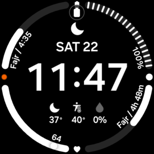
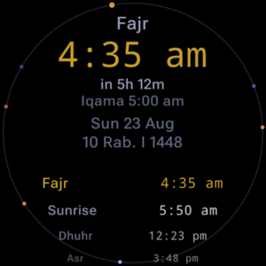
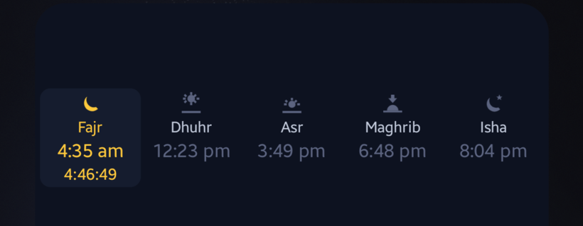
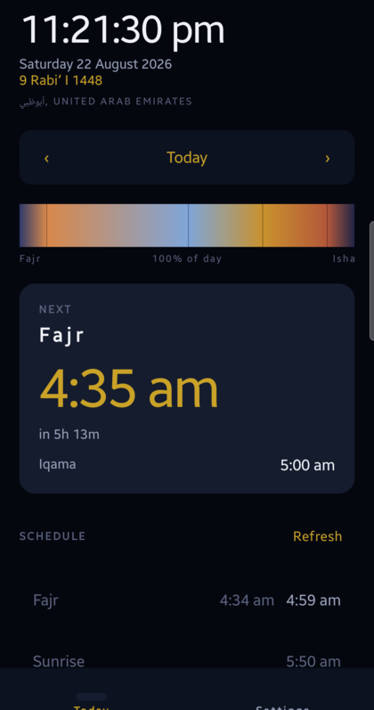
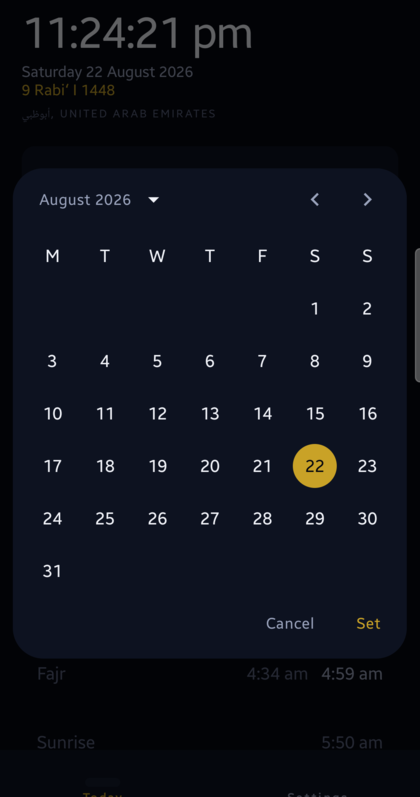
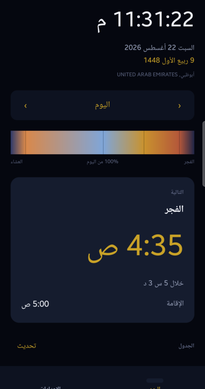
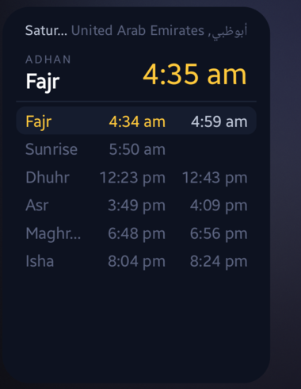

# SalahWatch

Islamic prayer times (Adhan and Iqama) as **Wear OS complications**, for Samsung Galaxy Watch.

Glance at your watch face and see the next prayer, when the Adhan is called, when the congregation
starts, and how long you have. Five separate complication providers mean you can fill several slots
on one watch face independently.

> **Status:** running on real hardware — a Galaxy S23 Ultra and a Galaxy Watch — with 180 unit tests
> passing and lint clean. Both apps, both widgets and the complications have been seen working.
> **[STATUS.md](STATUS.md)** lists what is verified, what is not, and what remains before release.

---

## What it looks like

All taken from a Galaxy S23 Ultra and a Galaxy Watch, running the current build.

| Watch face | Watch app |
|---|---|
|  |  |
| Two of the five providers filling separate slots — the next prayer's time on the left, its countdown on the right. | Opened by tapping any complication: what is next, how long, both calendars, and the day on the bezel. |

The one-row strip widget. The prayer being counted to is boxed and ticks to the second; the rest
show how long in whole hours, and prayers already passed are dimmed.



| Today | Any date, ±1 month | Arabic |
|---|---|---|
|  |  |  |

The schedule widget, which scales from three cells square down to two without ever dropping a
prayer:



---

## What it does

| Provider | Shows |
|---|---|
| **Prayer Time** | `Asr` / `3:50` — the next prayer's time, rolling over on its own |
| **Adhan Time/Countdown** | The time, becoming a countdown thirty minutes out, then the next prayer |
| **Prayer Progress** | The full cycle: time → countdown from an hour out → Iqama countdown → `Pray 3:12` → repeat |
| **Adhan Countdown** | `Asr` / `17m` |
| **Adhan / Iqama Countdown** | A countdown to the Adhan, then one to its Iqama |

Every one of them offers both a text and a gauge rendering, so it fits whichever kind of slot a
watch face provides. Countdowns show minutes at range and switch to `mm:ss` in the final fifteen
minutes before an Adhan, or ten before an Iqama.
Sunrise appears in the schedule but is never counted down to — it is not a prayer.

Tapping any complication opens the watch app, which shows the next prayer, a live countdown, both
calendars and the day's schedule.

The phone app shows a live clock, the Gregorian and Hijri date, the day arc, the next prayer with
time remaining, and the full schedule with passed prayers dimmed. Hijri dates come from `java.time`'s
Umm al-Qura calendar — no API call, and it cannot drift out of step with the prayer times. Any date
within a month either way can be browsed, by stepping a day at a time or by picking from a month
grid.

A **home screen widget** shows the five prayers and sunrise with their Adhan and Iqama times, headed
by the next Adhan or Iqama counting down — the same Adhan → Iqama → next-prayer cycle the watch
uses. Outside the seconds window it shows the target\'s clock time; inside it, a `Chronometer` the
system ticks. Either way this app is not running: see
[the note on not waking up](#the-app-does-not-wake-up-to-tick-a-clock).

### A note on what complications can and cannot do

This app supplies **data**; the watch face decides how to draw it. It can only appear on faces that
expose complication slots, and it cannot inject anything into a face that does not. That is a
platform property, not a limitation of this app.

---

## Design

The palette is taken from the sky, because that is what prayer times measure: pre-dawn indigo, dawn
violet, the pale gold of sunrise, zenith blue, afternoon amber, maghrib ember, night. Those same
values drive the day arc, so the arc is not decoration — it is the schedule drawn as light. The one
interface accent is **brass `#C9A227`**, the material Islamic astronomical instruments were made
from, and it is spent on exactly one thing: *now*.

Times are set in a monospaced face throughout. A prayer schedule is a column of figures, and
proportional digits make that column ripple; fixing the advance width is the difference between a
list that reads as data and one that reads as prose.

**The signature element is the day arc.** On the phone it is a horizontal band from Fajr to Isha with
the prayers marked where they fall and a brass line for the current moment. On the watch the same
idea becomes a ring around the bezel — midnight at twelve o'clock, a full 24-hour sweep — which puts
the shape of the day in the round margin that text cannot use anyway. Both answer "how far through
the day am I" without reading a single number.

Two further ideas do most of the work.

### The app does not wake up to tick a clock

Every provider is a `SuspendingTimelineComplicationDataSourceService`. Each hands the platform
**every prayer transition for the next 48 hours in a single response** — when the clock time becomes
a countdown, when that becomes an Iqama countdown, when it resets on the following prayer. Between
transitions this app does not run at all.

This is also what makes rollover correct. A provider that answers once and declares no update period
is never asked again, so it keeps showing whichever prayer was next when it was added; publishing
the transitions in advance means moving to the next prayer is not an event anything has to catch.

Live values inside those entries are `TimeDifferenceComplicationText`, which the watch face renders
itself, and the progress ring is a `DynamicFloat` expression the platform evaluates on-device at
1 Hz. **All five providers declare `UPDATE_PERIOD_SECONDS=0`** — the app requests no periodic wakeups
anywhere.

### The watch cannot reach the network

Fetching lives in `:data:prayer-sync`, which only the phone depends on. The watch depends on
`:data:prayer-times`, a read path with no HTTP client and no WorkManager.

The result, verified against the built APK:

| | Phone | Watch |
|---|---|---|
| `ACCESS_COARSE_LOCATION` | yes | — |
| `INTERNET` | yes | — |
| `WAKE_LOCK` / `FOREGROUND_SERVICE` | yes | — |
| `RECEIVE_BOOT_COMPLETED` | yes | yes |

The watch APK declares one permission and contains no OkHttp or WorkManager classes.

### Data flow

```
Phone: one annual AlAdhan fetch  →  Room  →  Data Layer (~6 KB)
                                                   ↓
Watch: Room  →  phase timeline  →  complication  →  watch face
         ↑
         └── adhan2 local calculation: offline fallback, marked "estimated"
```

One network request per location per year (~500 KB, about a second). Everything after that is local,
so the app works offline indefinitely.

---

## Prayer time accuracy

Times come from one of three sources, chosen in Settings.

**Official timetable** — the authority's own published table for your city, bundled with the app.
The only source that reproduces a national timetable *exactly*, because it is that table rather than
an approximation of it or a mosque's copy of it. Currently bundled for **Al Ain** and **Dubai**, from
the [UAE General Authority of Islamic Affairs, Endowments and Zakat](https://www.awqaf.gov.ae/prayer-times).

It needs no network at all: the data ships in the APK, so the exact times are available offline on a
fresh install. The trade is coverage — each bundle ends on the last day the authority had published
when it was captured, and past that the app falls back to calculation and marks the days
accordingly. Refreshing is a manual, roughly annual job (see `docs/OFFICIAL_TIMETABLES.md`).

Bundled files are validated at load rather than trusted: a transcription slip is silent by nature,
since every value in the file is a plausible time. A record of the wrong length, an impossible time,
a day out of order, or a date that does not exist in its month rejects the whole file, and the app
falls back to calculation instead of showing part of a bad table.

**Nearby mosque** — the published timetable of a mosque near you, via
[Mawaqit](https://mawaqit.net). Where a mosque follows its national timetable, its times *are* that
timetable rather than an approximation of it. Validated against an official national timetable for a
full month, the nearest mosque was within a minute on every prayer — exact on 27/31 days for Fajr
and 23/31 for Maghrib. Closer than any calculation reaches, including on the Sunrise no method
reproduces, but not identical to the authority's table: a mosque publishes its own. Works worldwide,
subject to a mosque publishing nearby.

Proximity does not imply agreement. Of the three mosques near Al Ain, two are byte-identical to each
other across all 366 days and **5 minutes out on Sunrise**; the third matches the official table
closely. Mosques agreeing with each other indicates a shared upstream, not an official one, which is
why the app never picks a table by consensus.

Mosque data is validated before it is trusted, because it is entered by people. Calendars carry six
*or seven* times a day, so the last six are taken — reading from the front would shift every prayer
by one slot, silently. And because at least one mosque declares a timezone it is not in, every
calendar is checked against an independently computed sunrise and rejected if it disagrees by more
than 45 minutes, falling back to calculation.

**Calculation** — the universal fallback, and the source everywhere the other two do not reach. From the
[AlAdhan API](https://aladhan.com/prayer-times-api), requested by latitude/longitude with
`iso8601=true` so every timestamp carries its own UTC offset and daylight saving needs no special
handling. Works anywhere, but a calculation can only ever approximate a national timetable: measured
against one, it lands within a minute on the five prayers and is consistently 4–5 minutes out on
Sunrise, which is method-independent and so cannot be corrected by choosing a different method.

All 23 of AlAdhan's methods are selectable, with their angles shown beside each name, so users can
pick the one their local authority uses.

When nothing is cached — a fresh install offline, or travel with no connection — times are computed
on-device with [adhan2](https://github.com/batoulapps/adhan-kotlin) and **marked as estimates**. The
disagreement between the two is measured, not assumed, by `AlAdhanGoldenTest` against 80 recorded API
responses across 5 locations, 2 methods, 2 schools and 4 dates:

| Prayer | Exact | Worst |
|---|---|---|
| Dhuhr, Maghrib | 80/80 | 0 min |
| Fajr, Sunrise, Isha | 76–78/80 | 1 min |
| Asr | 38/80 | 3 min |

Asr's error is school-dependent: Shafi spans −3..+2 while Hanafi never exceeds 1 minute. Shafi
defines Asr at a shadow ratio of 1×, earlier in the afternoon where solar altitude changes slowly, so
the same tiny discrepancy converts into a larger difference in minutes.

---

## Languages and appearance

English and Arabic throughout — every screen and every complication, including prayer names — with
layout direction following the language. The phone app offers light, dark
or system; the watch is always dark, because on an AMOLED display a black pixel is an unlit pixel.

## Requirements

- **Watch:** Wear OS 4 (API 33) or later — Galaxy Watch 4 onward. API 33 is where complication
  dynamic values begin; below it the progress ring cannot animate without polling.
- **Phone:** Android 10 (API 29) or later, paired to the watch.

## Building

Requires **JDK 21** — `adhan2` ships Java 21 bytecode, and JDK 17 fails at runtime with
`UnsupportedClassVersionError`.

```bash
JAVA_HOME=/path/to/jdk-21 ./gradlew build detekt
```

Install:

```bash
adb install app/build/outputs/apk/debug/app-debug.apk
adb install wear/build/outputs/apk/debug/wear-debug.apk
```

Set a location in the phone app first. Until then the watch shows `--:--`, which is the intended
empty state.

## Modules

```
build-logic/       convention plugins (included build, not buildSrc)
app/               phone: today's schedule, date browsing, settings, location, 2 home widgets
wear/              watch app + 5 complication services
core/model         domain types — pure JVM
core/calculation   PrayerCalendar, phase engine, adhan2 wrapper — pure JVM
core/database      Room, behind a narrow facade
core/preferences   DataStore
data/prayer-times  read path: cache + local fallback (no network)
data/prayer-sync   write path: AlAdhan + Mawaqit clients, syncer, WorkManager job
data/location      fused location + Geocoder
data/sync          Data Layer codec + publisher
```

`core/model` and `core/calculation` are pure JVM modules with no Android dependency, so the
timezone, DST and midnight-rollover logic is unit-testable without an emulator.

## Verification status

**Done:** 180 unit tests passing, detekt clean, lint clean, all four APKs build. Covered by tests: DST
transitions in both directions, timezone travel, Isha Iqama crossing midnight, the year boundary,
cache invalidation on moving or changing method, GPS jitter tolerance, Data Layer payload limits,
mosque calendar validation, corrections applied on read, both forms a mosque publishes its Iqama in,
the widgets' Adhan → Iqama → next-prayer cycle, the instants at which they re-render, how they
scale to the space a launcher gives them,
that a phase timeline is contiguous with no instant uncovered, and that a countdown's gauge measures
the whole wait rather than resetting when the text switches to seconds.

**Verified on hardware:** the phone app and the watch app, phone → watch sync between two real
devices, the nearby-mosque source finding and applying a real mosque's Iqama offsets, date browsing,
Arabic with European numerals throughout, both home screen widgets rendering with the countdown
ticking down, and two complications running on a real watch face.

**Still not verified:** the light theme, and — because both need a prayer to pass while someone is
watching — a redraw alarm firing exactly at an Adhan, and a complication gauge sweeping through one.
See [STATUS.md](STATUS.md).

## Documents

- **[STATUS.md](STATUS.md) — current state, pending work, and decisions not to revisit**
- [SPEC.md](SPEC.md) — the original requirements
- [RESEARCH.md](RESEARCH.md) — API research, verified findings, and the decisions taken
- [FUTURE_IMPROVEMENTS.md](FUTURE_IMPROVEMENTS.md) — deliberately deferred work

Release preparation lives in `docs/`:

- [docs/PLAY_STORE.md](docs/PLAY_STORE.md) — listing copy, build facts, and the blockers
- [docs/PRIVACY_POLICY.md](docs/PRIVACY_POLICY.md) — the policy text, which still needs hosting
- [docs/DATA_SAFETY.md](docs/DATA_SAFETY.md) — every answer on Play's Data safety form
- [docs/REVIEW_INSTRUCTIONS.md](docs/REVIEW_INSTRUCTIONS.md) — reviewer notes, and how to verify the APK
- [docs/SCREENSHOT_PLAN.md](docs/SCREENSHOT_PLAN.md) — the shot list, doubling as the device-test pass

## Privacy

Approximate coordinates are sent to whichever prayer-time source you choose — AlAdhan, or Mawaqit
when following a mosque — and to nothing else. The official-timetable source sends nothing anywhere:
it reads a file inside the app. Both are contacted anonymously: no account, no key,
no identifier. City lookup uses Android's own `Geocoder` on the device, which needs no API key and
no permission, so typing a city sends nothing through this app at all. There is no analytics and no
tracking, precise location is never requested, and background location is not declared in either
app. The watch app has no `INTERNET` permission.

Full text in [docs/PRIVACY_POLICY.md](docs/PRIVACY_POLICY.md), and the Play declarations it maps to
in [docs/DATA_SAFETY.md](docs/DATA_SAFETY.md).

## License

Free for personal, educational, and other non-commercial use — see [LICENSE](LICENSE) for the
full terms. Commercial use requires separate written permission from the copyright holder. Note this
is **not** an open-source licence, so the project should not be described as one.

Third-party components keep their own licences, reproduced in
[THIRD_PARTY_NOTICES.txt](THIRD_PARTY_NOTICES.txt). That file is compiled into both APKs as a raw
resource and shown in the phone app under **Settings → About → Open source licences**, because MIT
requires its notice to accompany every copy of the software and Apache 2.0 §4(a) requires shipping
the licence itself — a link, or a file only in this repository, satisfies neither. Prayer time
calculation uses [Adhan](https://github.com/batoulapps/adhan-kotlin), MIT, © 2016 Batoul Apps.
